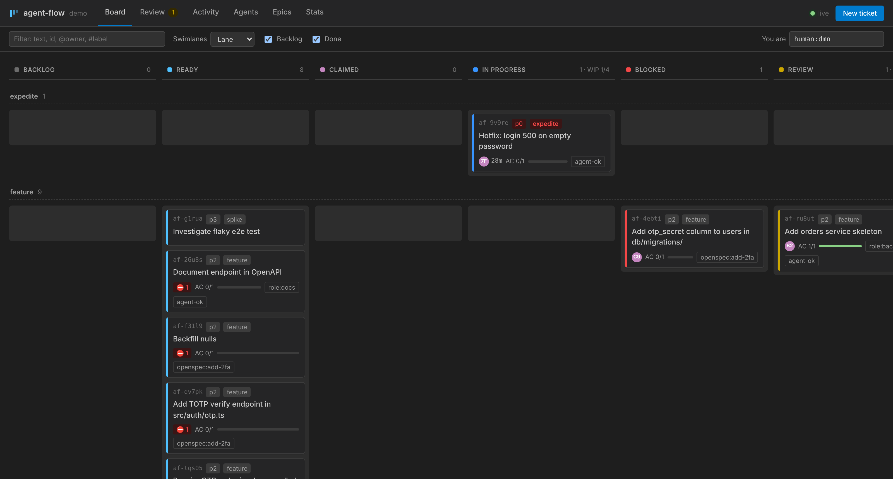

# synthet-agent-flow

**Agent-oriented project management.** agent-flow is a ticket tracker built for coding agents. It gives them:
- a **dependency-aware ready queue**,
- **atomic, leased claims**,
- **acceptance criteria that need evidence**,
- **review gates** and a **hash-chained audit log**.

You can drive it from a **CLI**, an **MCP server**, a **REST/SSE API** and a **web Kanban dashboard**. A **Claude Code plugin** (skills, hooks, agents) and a **Claude Code mod** (in-session pane) run the claim → spec → implement → verify → submit → next loop.



It plugs into the sibling projects:
- [synthet-code-framework](https://github.com/synthet/synthet-code-framework): agent-flow is a **backlog provider**, and it imports `/tasks` `T-n` tables.
- [synthet-agent-mailbox](https://github.com/synthet/synthet-agent-mailbox): sends **notifications** on claim, review, block and escalation.
- [synthet-agent-swarm](https://github.com/synthet/synthet-agent-swarm): **multi-harness review votes** on a ticket.
- [jev-mcp](https://github.com/synthet/jev-mcp): an **advisory evidence check** by Jev on a ticket in review.

## Why

Agents don't need Kanban columns so much as a deterministic query that returns unblocked work, plus an atomic way to take it. They also need specs written as prompts, evidence-based "done", and a thin layer of harness hooks that keeps them on task. agent-flow provides all of these and keeps the state git-friendly:
- **SQLite** (`node:sqlite`, no native deps) is the live state. It sits in `.agent-flow/flow.db` and every git worktree of the repo shares it.
- A deterministic **`tickets.jsonl`** snapshot is committed next to it.
- **GitHub** is an optional one-way mirror, not a two-way-synced master.

## Install

```bash
npm install -g github:synthet/synthet-agent-flow     # Node ≥ 22.13
# or: git clone … && cd synthet-agent-flow && npm install && npm link
```

In your project:

```bash
agent-flow init --dod "npm test"          # .agent-flow/{config.json,tickets.jsonl}, .gitattributes
agent-flow create "Add GET /api/orders with pagination" --ready -p p1 \
  --scope src/routes/orders.ts --ac "returns 20 orders per page" --ac "invalid params return 400"
agent-flow serve                           # dashboard on http://127.0.0.1:8791
```

Then wire up your agent harness. Pick one:

| Harness | How |
|---|---|
| Claude Code (recommended) | `/plugin marketplace add synthet/synthet-agent-flow`, then `/plugin install agent-flow@synthet-agent-flow` (and optionally `agent-flow-mod@synthet-agent-flow`) |
| Claude Code without the plugin | `agent-flow install --harness claude [--statusline]` writes the MCP server to `.mcp.json`, the hooks to `.claude/settings.json`, and a CLAUDE.md block |
| Cursor | `agent-flow install --harness cursor` writes `.cursor/mcp.json` and a `.cursor/rules/agent-flow.mdc` rule |
| Codex | `agent-flow install --harness codex` writes `~/.codex/config.toml` `[mcp_servers.agent-flow]` and an AGENTS.md block |
| synthet-code-framework project | `agent-flow install --framework .` adds the backlog-provider doc and the provider-order block |

Every install backs up the files it touches and writes a sha256 receipt. `agent-flow uninstall` restores only the files that are unchanged since the install.

### Windows tray app

On Windows, `run.cmd` installs what is missing, builds, restarts the tray app and exits. The app has no console or main window. It runs `agent-flow serve` for this checkout on http://127.0.0.1:8791, unless a dashboard already answers there. In that case it uses that dashboard, and **Quit** stops only the tray.

Click the tray icon to open the dashboard. Right-click it and choose **Quit** to stop. Starting the app while it runs opens the dashboard. Logs are in `%LOCALAPPDATA%\Agent Flow\agent-flow-tray.log`.

`scripts\install-shortcut.ps1` points the **Agent Flow** desktop shortcut at the tray app. Add `-Startup` to also start it at logon. The app is built from `tray\AgentFlowTray.cs` by the `csc.exe` that ships with .NET Framework 4, so nothing else is installed.

## The loop

```text
backlog ─promote─▶ ready ─claim─▶ claimed ─first commit─▶ in_progress ─submit─▶ review ─approve─▶ done
                     ▲   (atomic, leased)                    │  ▲  block/unblock      │
                     └────── release / lease expiry ─────────┘  └───── reject ────────┘ → 3× → blocked + needs-human
```

- **ready** is computed. A ticket is in the queue when its status is `ready`, every `blocks` dependency is done, and no live lease holds it.
- Queue order is the expedite lane first, then priority, then age. You can filter by `--label agent-ok`, by epic, or by skills (`skill:<x>` labels).
- **Claims** are a compare-and-set inside `BEGIN IMMEDIATE`. Eight processes racing `claim --next` never double-claim, and a test proves it.
  - Leases expire after 30 minutes unless heartbeated. An expired lease returns the ticket to the queue and counts an attempt.
- **WIP**: one active ticket per agent and four in flight by default.
- **Gates**:
  - `submit` needs a **handoff note** written since the claim, and the **Definition of Done** commands must pass.
  - `approve` needs **every AC Verified with evidence**, and the approver **must not be the owner**.
  - After `maxAttempts` rejections the ticket escalates to `blocked` with the `needs-human` label.
- **Epics** roll up automatically from their children.
- **Discovered work** goes in with `create --discovered-from <id>` instead of silent scope creep.
- **Audit**: every change is an append-only event, chained by SHA-256 over canonical JSON. Run `agent-flow audit verify`.

## Claude Code integration

| Piece | What it does |
|---|---|
| `SessionStart` hook | Injects the ticket bound to your branch (`af/<id>-…`): spec, AC, last handoff, last review. With no bound ticket it injects the ready queue. Exports your actor id through `CLAUDE_ENV_FILE`. Re-runs after compaction. |
| `PreToolUse` (Bash) | Denies force-push, pushes to the default branch, `rm -r` outside the worktree, and a second claim beyond your WIP limit. It never returns `allow`. |
| `PostToolUse` | On the first real commit, moves the ticket from `claimed` to `in_progress`. Sends heartbeats and records the commit in the session row. If you commit or run `gh pr create` while holding no ticket, it reminds you once per session to create or claim one (`hooks.untrackedNudge`, on by default). |
| `Stop` | Loop controller: keeps going while labelled ready work remains. Honours `stop_hook_active`, the ticket cap, the `.agent-flow/STOP` file and no-progress detection. Outside a loop it nudges once for a missing handoff. |
| `StopFailure` / `PreCompact` / `SessionEnd` / `TaskCompleted` | `StopFailure` halts the loop on API errors. `PreCompact` and `SessionEnd` record transcript pointers (and flag a missing handoff). `TaskCompleted` is an optional DoD gate. |
| Skills | `/agent-flow:flow-next`, `flow-work`, `flow-complete`, `flow-review`, `flow-plan`, `flow-loop`, `flow-land`, `flow-status`, plus the model-invoked `agent-flow` rules skill. |
| Agents | `flow-reviewer` verifies AC independently. `flow-planner` turns a spec into a ticket graph. |
| MCP | The `flow_*` tools (ready, claim, transition, ac, comment, …) and the `flow://workflow/overview` resource. |
| Mod | `/flow-board` pane (ticket, AC checklist, ready queue), a band shown during review or when blocked, a status line entry, and toasts. |
| Status line | `agent-flow statusline` prints `⚑ af-k3x9q · in_progress · lease 12m · AC 1/3 · ready 4`. |

### Autonomous runs

```bash
agent-flow loop start --max 3 --label agent-ok    # in-session: the Stop hook drives the next ticket
agent-flow loop run   --max 5 --label agent-ok    # outer loop: one fresh `claude -p` per ticket (most robust)
touch .agent-flow/STOP                            # kill switch (or: agent-flow loop stop)
```

Both modes follow the framework's *autonomous-run-contract*: a budget, a label scope, and explicit stop conditions. They never merge. Claude Code caps consecutive Stop-hook continuations at 8; raise `CLAUDE_CODE_STOP_HOOK_BLOCK_CAP` or use `loop run` for longer runs.

### Parallel agents

```bash
agent-flow claim --next --json          # each agent, own actor id
agent-flow worktree create <id>         # one worktree per ticket; creation is serialised by a DB lock
```

## Spec-driven development

Scale the ceremony to the work. A bug or chore is one ticket. A feature gets a spec, then tasks, then an import:

```bash
agent-flow import-tasks specs/orders/tasks.md --spec specs/orders/spec.md --dry-run   # framework /tasks T-n table
agent-flow import-tasks specs/001-albums/tasks.md                                     # Spec Kit (- [ ] T001 [P] …)
agent-flow import-tasks openspec/changes/add-2fa                                      # OpenSpec change folder
agent-flow import-backlog .agent/backlog/items.md                                     # framework Local Markdown backlog
```

Each import creates an epic plus tickets, and carries over dependencies, scope paths, AC text and `spec_ref`. Re-imports are idempotent.

## Integrations

- **GitHub** (via `gh`):
  - `agent-flow github push` mirrors tickets to issues, puts epics' children in as sub-issues, and keeps the status labels current.
  - `github pr <id>` opens a PR whose body starts with `Refs <id>` and includes an AC checklist.
  - `github reconcile` (also run at session start) and the signed `POST /hooks/github` webhook map PR state back: changes requested → reject, merged → done.
- **synthet-agent-mailbox**: set `mailbox.enabled` and a `scope`. Claim, review, rejection, block, needs-human, done and lease-expiry events are published to the mailbox journal through its MCP server (subscribe, then publish, with idempotency keys). Optionally they also go to a reviewer peer with `agent-mail send`. Delivery runs through a retrying outbox and never blocks a write.
- **synthet-agent-swarm**: `agent-flow review <id> --swarm` calls the swarm's `swarm_run` tool (mode `review`) to ask the installed harnesses (Codex, Claude Code, Antigravity, …) for read-only verdicts, one per criterion. The strict-majority votes are recorded as a review comment. Auto-approval is opt-in.
- **jev-mcp**: `agent-flow review <id> --jev` asks Jev, through a jev-mcp checkout, whether each criterion's recorded evidence shows it is met. The answer is an advisory review comment by `system:jev`; Jev never approves, rejects or verifies. `jev.onSubmit` runs it after every submit, and is off by default because each run is a paid call.

Details: [docs/integrations.md](docs/integrations.md).

## Reference

- [docs/architecture.md](docs/architecture.md) covers the data model, concurrency, the audit chain and the security model.
- [docs/api.md](docs/api.md) covers the CLI, MCP tools, REST endpoints and hook I/O.
- [docs/integrations.md](docs/integrations.md) covers GitHub, the mailbox, the swarm, the framework, the loop and the installer.
- [AGENTS.md](AGENTS.md) explains how to work on this repo.

## Development

```bash
npm install
npm run build && npm test           # vitest: store, CLI (incl. multi-process race), importers, MCP, server, hooks, integrations
claude plugin validate plugin && claude plugin validate mod && claude plugin test mod
```

MIT licensed.
